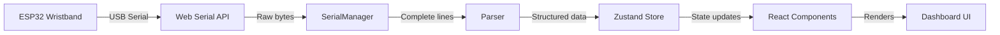

# 🏗️ Architecture

> System design and data flow for the TinyGest Dashboard.

## Data Flow

## Module Architecture

### Connection Layer
- **`SerialManager`** (`src/lib/serialManager.ts`)
  - Web Serial API wrapper
  - Byte buffering into lines
  - USB disconnect detection
  - Port selection and baud rate configuration

### Parsing Layer
- **`parser.ts`** (`src/lib/parser.ts`)
  - `parseVoiceLine()` — Voice mode serial parser
  - `parseGestureLine()` — Gesture mode serial parser
  - Handles KEY:VALUE, JSON, [TAG], and text patterns
  - **Update this when ESP32 code is provided**

### State Layer
- **`dashboardStore.ts`** (`src/store/dashboardStore.ts`)
  - Zustand store with all dashboard state
  - Rolling sensor history (configurable max points)
  - Event queue with bounded length
  - Session statistics computed on each ingestion
  - UI state (paused, modals, settings)

### Presentation Layer
| Component | Purpose |
|---|---|
| `Navbar` | Brand, connection status, mode, timer |
| `ConnectModal` | Port selection, baud rate, mode toggle |
| `DeviceHero` | Main status card with latest action |
| `SensorCharts` | Auto-grouped real-time line charts |
| `VoicePanel` | Voice command display and frequency |
| `GesturePanel` | Gesture detection with emoji icons |
| `EventTimeline` | Color-coded event feed |
| `SerialConsole` | Raw serial output (collapsible) |
| `StatsPanel` | Session statistics and CSV export |
| `SettingsPanel` | Configuration and session reset |

### Utility Layer
- **`csvExport.ts`** — Export events and sensor data to CSV
- **`demoMode.ts`** — Simulated data generator for UI testing

## Design Decisions

1. **Web Serial API over WebSocket bridge** — Eliminates Python dependency, direct browser-to-USB connection
2. **Zustand over Redux** — Minimal boilerplate, selective subscriptions prevent unnecessary re-renders
3. **Auto-grouped charts** — Sensors with common prefixes (ACCEL_X, ACCEL_Y, ACCEL_Z) are automatically grouped into one chart
4. **Rolling history window** — Bounded memory usage with configurable max data points
5. **Pause/Resume display** — Pausing the visual display does NOT disconnect the serial port or stop data recording

## Related

- [[TinyGest Dashboard]]
- [[Serial Protocol]]
- [[Component Reference]]
