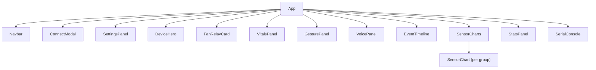

# 🧩 Component Reference

> UI component documentation for the TinyGest Dashboard.

## Component Tree

## Hardware-Specific Components (`gesture_relay_final`)

### FanRelayCard
**File:** `src/components/FanRelayCard.tsx`
- Controls ESP32 Relay on **GPIO 13** (Active-LOW: 0V = ON, 3.3V = OFF)
- Animated spinning ventilation fan illustration with speed dynamics
- Active/Standby status pills and live hardware pin readouts
- Action logs (e.g. `ACTION: FAN ON`, `ACTION: FAN OFF`)
- Dedicated hardware-only relay trigger feedback (autonomous control via TinyML model predictions)

### VitalsPanel
**File:** `src/components/VitalsPanel.tsx`
- Displays biometric vitals from **MAX30100 Pulse Oximeter** (I2C: SDA 18 / SCL 19)
- **Heart Rate**: Real-time BPM with animated pulsating heart icon, min/avg/max session metrics, clinical resting zones
- **Blood Oxygen (SpO₂)**: Real-time saturation percentage with graphical bar gauge and health tier badges (Optimal / Normal / Low)
- Sensor readiness indicator (Initialized / Active / Not Detected)

### GesturePanel
**File:** `src/components/GesturePanel.tsx`
- Dedicated to Edge Impulse **`real_gesture_data`** model
- Live probability distribution progress bars for all 3 classes:
  - `fan_on` (Trigger: turns Fan Relay ON)
  - `fan_off` (Trigger: turns Fan Relay OFF)
  - `idle` (Neutral resting wrist position)
- **65% Confidence Threshold** vertical marker and validation badge
- Detected gesture hero card with corresponding action status
- Real-time sampling state banner during MPU-6500 data capture

### VoicePanel
**File:** `src/components/VoicePanel.tsx`
- Dedicated to Edge Impulse **`voice_train`** model (`voice.ino`)
- Hardware: INMP441 I2S Digital Microphone (SCK 33, WS 25, SD 32 @ 16 kHz)
- Live animated audio recording waves ("Recording audio... Speak your command")
- Neural classification inferencing animation banner
- Real-time probability distribution progress bars for all 4 classes:
  - `fan_on` (Trigger: turns Fan Relay ON via GPIO 13 LOW)
  - `stop` (Trigger: turns Fan Relay OFF via GPIO 13 HIGH)
  - `noise` (Background ambient sound filtered out)
  - `unknown` (Unrecognized acoustic phonemes)
- **70% Confidence Threshold** vertical line marker and validation badge
- Detected command hero card with execution status pill
- Live hardware telemetry (I2S interface, 16kHz sample rate, 16,000 window count, GPIO 13 relay)
- Recent voice command history log with confidence badges

---

## Core Components

### Navbar
**File:** `src/components/Navbar.tsx`
- Brand logo with TinyGest indicator
- Prominent **"Connect ESP32 (USB)"** button for instant Web Serial connection
- Live hardware serial status pill with connection animation
- Session timer & clock
- Settings modal trigger

### ConnectModal
**File:** `src/components/ConnectModal.tsx`
- Web Serial API COM port picker (`navigator.serial.requestPort()`)
- Baud rate selector (defaults to **115200** to match ESP32 firmware)
- Step-by-step instructions on closing the Arduino IDE Serial Monitor

### DeviceHero
**File:** `src/components/DeviceHero.tsx`
- ESP32 hardware identity badges (MPU-6500, MAX30100, Relay GPIO 13, Edge Impulse)
- Quick-glance biometric vitals (BPM & SpO₂) and Fan state
- Direct connection trigger when offline

### SensorCharts
**File:** `src/components/SensorCharts.tsx`
- Dedicated biometric telemetry time-series charts using Recharts:
  - **Heart Rate (MAX30100)**: Real-time BPM trend (domain 50–120) with rose accent curve
  - **Blood Oxygen SpO₂ (MAX30100)**: Real-time saturation % trend (domain 88–100) with cyan accent curve
- Real-time time-series aggregation from incoming serial stream
- Tooltips with localized timestamp formatting and unit indicators
- Side-by-side responsive layout aligned with biometric vitals tracking

### SerialConsole
**File:** `src/components/SerialConsole.tsx`
- Real-time mirror of the Arduino IDE Serial Monitor via Web Serial API
- Syntax highlighting: Green (Fan actions), Cyan (Vitals), Violet (Gestures), Amber (Warnings), Red (Errors)
- Filter pills: All, Actions, Vitals, Gestures, Errors
- Pause / Resume and CSV export

### StatsPanel
**File:** `src/components/StatsPanel.tsx`
- Session duration, total raw messages, throughput rate
- Sensor min/max/avg summary
- CSV export triggers

### SettingsPanel
**File:** `src/components/SettingsPanel.tsx`
- History buffer points configuration
- Session reset controls

---

## Related
- [[Architecture]]
- [[Serial Protocol]]
- [[Session Log]]
